<p align="center">
  
</p>

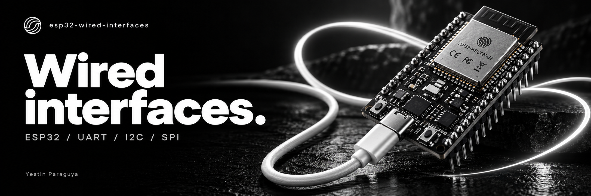

# ESP32 Wired Interfaces

I tested UART, I²C, and SPI on an ESP32-WROOM-32 for BCA188 Laboratory Activity 8. This repository contains my sketches, wiring photos, screenshots, and results.

**Yestin Paraguya**

<p>
  
  
  
  
</p>

[Overview](#overview) · [Pin plan](#pin-plan) · [Wiring](#wiring) · [Results](#expected-versus-observed) · [UART](#uart-loopback) · [I²C](#i2c-address-scanner) · [SPI](#spi-loopback) · [Baud test](#baud-rate-comparison) · [Answers](#lab-answers)

<a id="overview"></a>

##  Overview

For UART and SPI, I connected a loopback jumper so the ESP32 could receive the data it sent. For I²C, I connected an OLED and scanned for its address.

| Interface | What is tested | Observed with connection | Observed without connection |
|---|---|---|---|
| UART | `Serial2` TX-to-RX loopback | Repeated `PING` | No repeated `PING` |
| I²C | OLED address acknowledgement | `Found device at 0x3C` | `No I2C devices found` |
| SPI | MOSI-to-MISO byte loopback | Sent `0xA5`, received `0xA5` | Received `0x0` (`0x00`) |

The UART baud-rate comparison also showed unreadable characters when the sketch and monitor used different speeds, followed by readable `PING` when both used 9600 baud.

> Evidence note: the screenshots and wiring photos below are the original lab captures. The cover is AI-generated decorative artwork, not a wiring reference or photograph of the actual build. No oscilloscope or logic-analyzer measurements are claimed.

<a id="hardware-and-software"></a>

##  Hardware and software

| Item | Used for |
|---|---|
| ESP32-WROOM-32 development board | Runs all three sketches |
| USB data cable | Uploading, board power, and Serial Monitor |
| Breadboard and jumper wires | Loopback and OLED connections |
| Four-pin I²C OLED | Address scan; detected at `0x3C` |
| Arduino IDE | Editing, compilation, upload, and Serial Monitor |
| `esp32 by Espressif Systems` version **3.3.12** | ESP32 board support |
| Built-in `Wire.h` and `SPI.h` | I²C and SPI; no separate display library required |

Board selection: **ESP32 Dev Module**. The port during this build was **COM3**; another computer may assign a different port. Upload speed was set to **115200** after a checksum error at the higher setting. Upload speed and the sketch's serial baud rate are separate settings.

<details>
<summary> Environment screenshots: board support and selected port</summary>

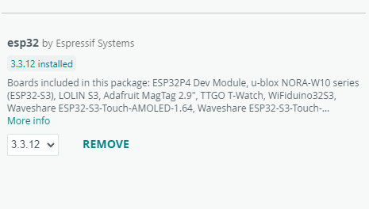

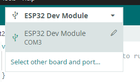

</details>

<a id="pin-plan"></a>

##  Pin plan

These are the **final** assignments used in the saved sketches. Each signal has its own GPIO.

| Signal | GPIO | Role |
|---|---:|---|
| UART TX | 17 | Transmit `PING` |
| UART RX | 16 | Receive returned bytes |
| I²C SDA | 21 | OLED data |
| I²C SCL | 22 | OLED clock |
| SPI SCK | 14 | SPI clock output |
| SPI MOSI | 23 | Transmit byte |
| SPI MISO | 19 | Receive returned byte |
| SPI CS | 4 | Chip-select output, HIGH between transfers |

OLED power is **3V3 → VCC** and **GND → GND**. GPIO numbers are the board's printed GPIO labels, not physical pin positions.

<a id="wiring"></a>

##  Wiring

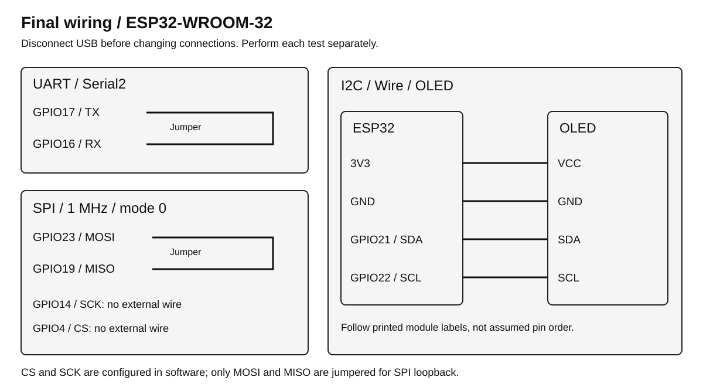

- **UART:** one jumper from GPIO17 to GPIO16.
- **I²C:** OLED VCC to 3V3, GND to GND, SDA to GPIO21, SCL to GPIO22.
- **SPI:** one jumper from GPIO23 to GPIO19. GPIO14 and GPIO4 are configured but have no external wires in this loopback test. Do not connect SCK or CS to MOSI/MISO.

Disconnect USB before changing any wire. Use the module's printed pin labels and a shared ground. Keep the OLED supply at 3.3 V for this build. The OLED stays blank during the scanner test because the sketch does not initialize the display or draw pixels.

<a id="expected-versus-observed"></a>

##  Expected versus observed

The Expected column records the predictions discussed before testing. The Observed column records what appeared during the tests; the screenshots are included below.

| Test | Expected | Observed |
|---|---|---|
| UART with jumper | `PING` once per second | `PING` appeared about 1–2 seconds after reset, then repeated every second |
| UART without jumper | No repeated `PING` because the receive path is open | No repeated `PING`; startup messages only during the observation |
| I²C with module | OLED responds at its address, commonly `0x3C` | `Found device at 0x3C` |
| I²C without module | No device acknowledges | `No I2C devices found` |
| SPI with jumper | Receive the transmitted byte `0xA5` | `Sent 0xA5, received 0xA5` |
| SPI without jumper | Unreliable received data, often `0x00` or `0xFF` | `Sent 0xA5, received 0x0` repeatedly |
| Sketch at 9600, monitor at 115200 | Unreadable output or no readable `PING` | Unreadable square characters |
| Sketch at 9600, monitor at 9600 | Readable `PING` once per second | Readable repeated `PING` |

`0x0` and `0x00` represent the same byte. A disconnected input can float: its value is not guaranteed, and a disconnected reading is not a reliable measurement of signal quality.


<a id="uart-loopback"></a>

##  UART loopback

 **Sketch:** [uart_loopback.ino](uart_loopback/uart_loopback.ino)

**Data path:** `Serial2 → GPIO17 → jumper → GPIO16 → Serial2 receive buffer → Serial → USB → Serial Monitor`.

`Serial2.begin(9600, SERIAL_8N1, 16, 17)` configures 9600 baud, eight data bits, no parity, and one stop bit. `Serial.begin(115200)` configures the separate connection used for computer output. These two paths can use different speeds. The sketch sends with `millis()` once per second and forwards every received byte to the monitor.

```text
PING
PING
PING
```

Removing the jumper breaks the return path. The sketch continues transmitting, but it has no returned `PING` to print. ESP32 startup messages after reset are separate from the loopback result.

<details>
<summary> UART evidence: wiring, connected output, and disconnected output</summary>

**Wiring — GPIO17 TX to GPIO16 RX**

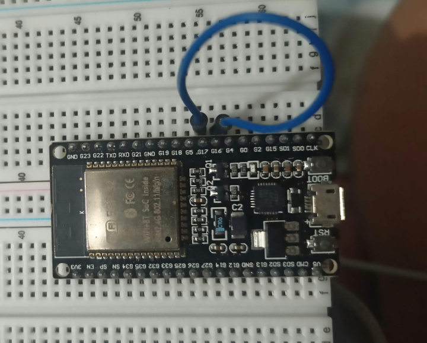

**With jumper — repeated PING**

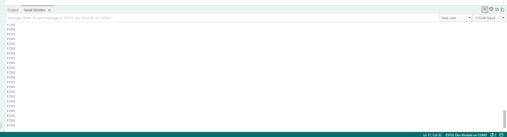

**Without jumper — no repeated PING**

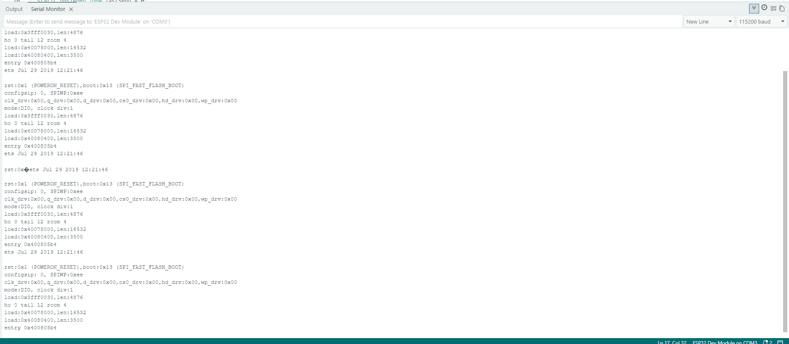

I pressed RST several times while testing, which produced the repeated startup messages in this screenshot.

</details>


<a id="i2c-address-scanner"></a>

##  I2C address scanner

 **Sketch:** [i2c_scanner.ino](i2c_scanner/i2c_scanner.ino)

**Data path:** the ESP32 sends an address over SDA, using SCL for timing; an attached device acknowledges its matching address. The sketch reports acknowledgements through USB serial.

`Wire.begin(21, 22)` selects SDA and SCL. The scanner tries `0x01` through `0x7E` **once in `setup()`**. Reset after connecting or disconnecting the module to run another scan. The OLED does not need a graphics library for address detection.

```text
With OLED:     Found device at 0x3C
Without OLED:  No I2C devices found
```

The final build uses GPIO21/GPIO22. The earlier GPIO32/GPIO33 attempt found no devices; changing the pin pair resolved detection, but the underlying cause was not established.

<details>
<summary> I2C evidence: OLED wiring and both scan results</summary>

**Wiring — SDA 21, SCL 22, VCC 3V3, GND**

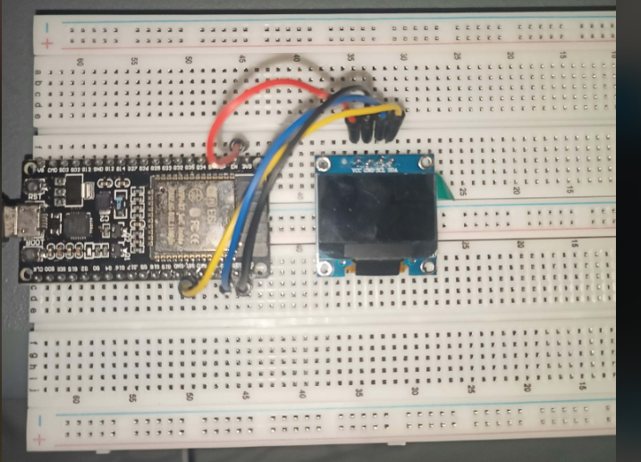

**With OLED — address 0x3C**

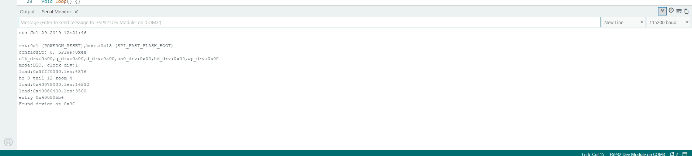

**Without OLED — no device replies**

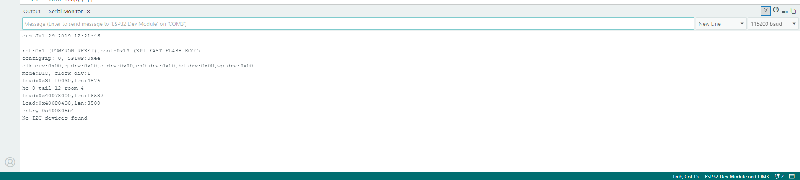

</details>


<a id="spi-loopback"></a>

##  SPI loopback

 **Sketch:** [spi_loopback.ino](spi_loopback/spi_loopback.ino)

**Data path:** `SPI transmit → GPIO23 MOSI → jumper → GPIO19 MISO → SPI.transfer() return value → Serial Monitor`.

| Setting | Value |
|---|---|
| Initialization order | `SPI.begin(SCK, MISO, MOSI, CS)` |
| Final initialization | `SPI.begin(14, 19, 23, 4)` |
| Clock | 1 MHz |
| Bit order | Most-significant bit first (`MSBFIRST`) |
| Mode | Mode 0 (`SPI_MODE0`) |
| Transmitted byte | `0xA5` |
| Interval | Once per second |
| CS sequence | LOW before transfer, HIGH afterward |

```text
With jumper:     Sent 0xA5, received 0xA5
Without jumper:  Sent 0xA5, received 0x0
```

This verifies the returned byte through the loopback path. There is no external SPI peripheral, so CS does not select a physical device here. The loopback alone does not verify a peripheral's CS response or measure SCK timing.

<details>
<summary> SPI evidence: final wiring and both output captures</summary>

**Final wiring — GPIO23 MOSI to GPIO19 MISO**

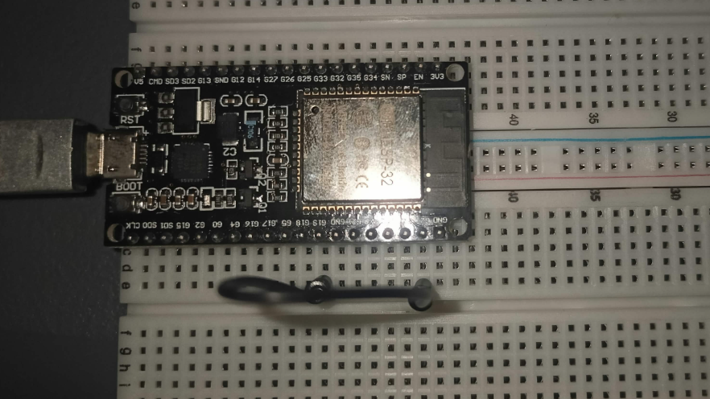

**With jumper — transmitted byte returned**

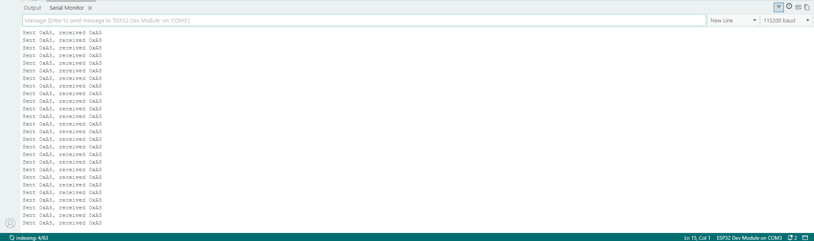

**Without jumper — received 0x0**

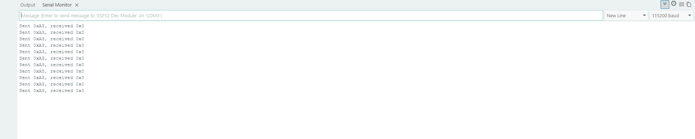

The output captures were retained when moving from the diagnostic GPIO17/GPIO16 pair to final GPIO23/GPIO19. I repeated the tests with the final pins and got the same values. The updated wiring photograph shows that pin pair. Serial output alone does not identify which GPIO pair was connected.

</details>

<a id="baud-rate-comparison"></a>

##  Baud-rate comparison

For this test, the UART jumper was connected and **only `Serial.begin()`** was changed to 9600. `Serial2` remained at 9600 throughout.

| Sketch USB serial | Monitor | Observation |
|---:|---:|---|
| 9600 | 115200 | Unreadable square characters |
| 9600 | 9600 | Readable repeated `PING` |
| 115200, restored | 115200 | Readable `PING` confirmed again |

<details>
<summary> Baud-rate evidence: mismatched and matched speeds</summary>

**Mismatch — sketch 9600, monitor 115200**

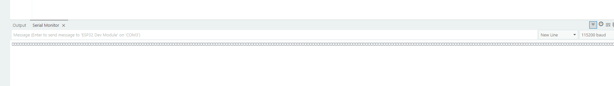

**Match — sketch 9600, monitor 9600**

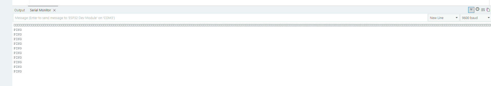

</details>

The saved UART sketch is restored to `Serial.begin(115200)`, with `Serial2` still using 9600. Startup text may use a different fixed boot baud; assess the repeated application output for this comparison.

<a id="run-the-laboratory"></a>

##  Run the laboratory

1. Install Arduino IDE and the ESP32 board package. Select **ESP32 Dev Module** and the board's detected port.
2. With USB disconnected, wire the chosen test according to the final diagram. Test one sketch at a time.
3. Open the corresponding `.ino` inside its matching sketch folder. Confirm the GPIO constants match the wiring.
4. Reconnect USB and upload. If needed, use **Tools → Upload Speed → 115200**.
5. Open Serial Monitor at **115200**. Press RST after opening it, especially for the one-time I²C scan.
6. Record the connected result. Disconnect USB, remove the test connection, reconnect, reset, and record the disconnected result.
7. For the baud experiment, reconnect the UART loopback with USB disconnected, change only USB `Serial.begin()` to 9600, and compare monitor settings 115200 and 9600.
8. Restore `Serial.begin(115200)`, upload, set the monitor to 115200, and verify readable output.

<a id="troubleshooting-record"></a>

##  Troubleshooting record

| Observation | Action and result | What remains uncertain |
|---|---|---|
| An initial UART startup appeared delayed by about ten seconds | Later resets consistently showed `PING` after about 1–2 seconds | The intermittent initial delay was not isolated |
| I²C scan found nothing on GPIO32/GPIO33 | Changed SDA/SCL and code together to GPIO21/GPIO22; OLED replied at `0x3C` | Original failure cause was not established; no damaged GPIO claim is made |
| Initial SPI loopback returned `0x0` and `0xFF` | A diagnostic test used the known-working UART pair; final SPI uses distinct GPIO23/GPIO19 and returned `0xA5` | The original SPI pin-path failure was not isolated |
| Upload failed with `Failed to write to target RAM` and a checksum error | Reduced upload speed to 115200; uploading succeeded | This does not by itself establish a faulty cable or board |
| OLED stayed blank | Expected for an address-only scanner | Drawing text or graphics is outside this lab's required tests |

<a id="lab-answers"></a>

##  Lab answers

### 1.  Why does UART need matching baud rates while SPI uses a clock line?

UART has no shared clock line, so both ends must agree on the baud rate and frame format to sample bits at the right times. SPI supplies SCK alongside the data, allowing the receiver to sample on the configured clock edges.

### 2.  Why can two devices with the same address not share one I²C bus?

On a normal shared I²C bus, both devices would respond to the same address, so the controller could not select them independently and read data could conflict. Use distinct addresses, separate buses, or an I²C multiplexer when identical-address devices must be controlled separately.

### 3.  Why is CS HIGH between SPI transfers?

For an active-low SPI peripheral, CS HIGH deselects it and marks the end of its transaction according to the device protocol. This prevents it from treating other bus traffic as part of its transfer and allows another peripheral to be selected.

<a id="repository-structure"></a>

##  Repository structure

```text
esp32-wired-interfaces/
├── README.md
├── assets/
│   ├── cover.png
│   ├── project-logo.svg
│   ├── badge-*.svg
│   ├── section-*.svg
│   ├── wiring.svg
│   └── icons/                 # Lucide SVGs and upstream license
├── uart_loopback/
│   └── uart_loopback.ino
├── i2c_scanner/
│   └── i2c_scanner.ino
├── spi_loopback/
│   └── spi_loopback.ino
└── evidence/                  # 13 original screenshots and wiring photographs
```

<a id="documentation-and-credits"></a>

##  Documentation and credits

- **Hardware work and test evidence:** Yestin Paraguya. The captures document this individual laboratory build.
- **Icons:** [Lucide](https://lucide.dev/), distributed as static SVGs because GitHub README files do not execute React components. See [upstream license](assets/icons/LICENSE).
GitHub controls the page theme. The cover and graphics stay black and white; the text and tables follow your GitHub settings.

---

**Yestin Paraguya · BCA188 · ESP32 Wired Interfaces**
